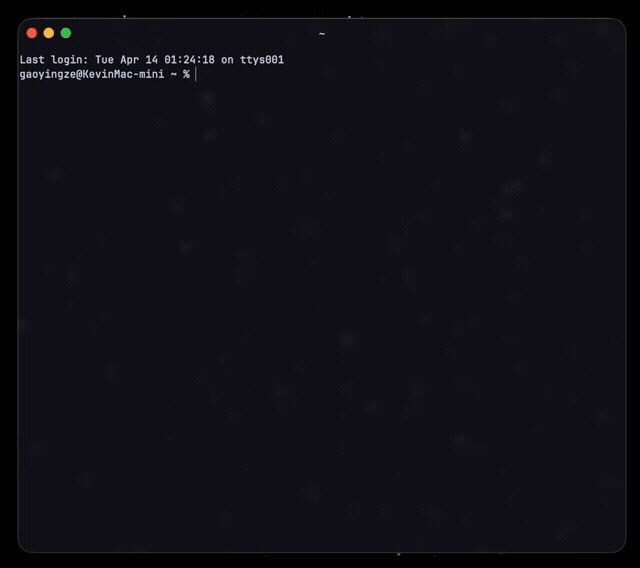

# mcp-multi-model

**Give Claude Code superpowers — image gen, video gen, web search, and smart multi-model routing.**

One MCP server. All the models you need. Zero tab-switching.



```bash
npx mcp-multi-model
```

> If you find this useful, please give it a ⭐ — it helps others discover the project!

---

## What can it do?

### 🎨 Generate images and videos — right in the terminal

> "Generate a macOS app icon with a glowing indigo orb"

Claude calls **Nano Banana 2 / Nano Banana Pro / GPT Image 2**, saves the PNG, and opens it. No browser, no Figma, no context switch.

Video too — **Veo 3.1** generates short clips from a text prompt.

### 🧠 Smart routing — the right model for the job

Need reasoning / agentic coding → it routes to **OpenAI GPT-6 / GPT-5.6 / o-series** (auto-handles `max_completion_tokens`, skips `temperature` where unsupported).
Tell Claude to research something → it routes to **Gemini** (Google Search grounding).
Ask it to write code cheaply → it routes to **DeepSeek** (fast, cheap, great at code).
Need real-time info in Chinese → it routes to **Kimi** (web search).

You don't pick the model. The routing does it for you.

### ⚖️ Compare models side by side

> "Ask both DeepSeek and Gemini how to implement a B-tree"

Two answers, one terminal. See which model gives you a better solution.

### 🌐 Web search built in

Gemini uses Google Search grounding. OpenAI GPT-5.6 / GPT-6 search via the Responses API `web_search` tool (`openai-search` / `openai-pro-search`, source URLs attached). Kimi searches the Chinese web. No separate browser-use MCP needed.

### 🔧 One-line install

```json
{
  "mcpServers": {
    "multi-model": {
      "command": "npx",
      "args": ["-y", "mcp-multi-model"],
      "env": {
        "DEEPSEEK_API_KEY": "sk-...",
        "GEMINI_API_KEY": "AI..."
      }
    }
  }
}
```

That's it. No git clone, no build step.

---

## Supported Models

12+ providers preconfigured in `config.example.yaml`. Models without an API key are skipped automatically.

| Provider | Adapter | Why use it |
|---|---|---|
| **OpenAI** | `openai`, `openai-responses` | GPT-6 Astra / GPT-5.6 reasoning, o-series, GPT Image 2. `openai-responses` adds Responses API web search with cited sources. Reasoning param handling is automatic (`max_completion_tokens`, temperature skipped where unsupported). |
| **Gemini** | `gemini` | Long context, Google Search grounding. Image (Nano Banana 2 / 2 Lite / Pro) and video (Veo 3.1) generation built in. |
| **DeepSeek** | `openai` | Code, math, logic — extremely low cost |
| **Kimi** (Moonshot) | `openai` | Kimi K2.6 Chinese web search (tool-calling loop) + Kimi K3 flagship reasoning |
| **Grok** (xAI) | `openai` | Real-time X/Twitter context, reasoning |
| **Perplexity** | `openai` | Sonar models with built-in web search and citations |
| **Anthropic** (via OpenRouter) | `openai` | Claude models routed through OpenRouter |
| **Mistral / Groq / Qwen / GLM / Together** | `openai` | EU AI, ultra-fast inference, Chinese-native, open-source aggregators |
| **Ollama / LM Studio / llama.cpp / vLLM** | `openai` | **Local — no API key, no cost, full privacy** |

Adding a new model is one block in `config.yaml` — see [Configuration](#configuration).

## Why these defaults — measured

The `routing.categories` table in `config.yaml` is backed by a small benchmark in [`eval/`](eval/README.md): 5 task types × 4 prompts × 6 models, run through the server's own adapters (same timeouts, retries, flags and pricing that `delegate` uses). Code is scored by hidden tests in a `node --permission` sandbox, extraction by field-level JSON match, reasoning by exact answer, research and creative by a blind rubric grade. First run 2026-10-21: 120 calls, **$0.78 total**.

| model | code | extraction | reasoning | research | creative | **overall** | avg $/call | median s | timeouts |
|---|---:|---:|---:|---:|---:|---:|---:|---:|---:|
| DeepSeek V4 Flash (`deepseek`) | 100 | 97 | 100 | 100 | 65 | **92** | $0.0003 | 2.5 | 0/20 |
| Gemini 3.8 Flash (`gemini`) | 75 | 100 | 100 | 95 | 85 | **91** | $0.0059 | 11.7 | 1/20 |
| GPT-5.6 Luna (`openai`) | 85 | 97 | 100 | 100 | 65 | **89** | $0.0004 | 5.1 | 0/20 |
| Kimi K2.6 + web search (`kimi`) | 50 | 100 | 100 | 90 | 55 | **79** | $0.0064 | 33.9 | 3/20 |
| DeepSeek V4 Pro (`deepseek-pro`) | 75 | 100 | 100 | 90 | 80 | **89** | $0.0012 | 9.9 | 1/20 |
| Gemini 3.1 Pro (`gemini-pro`) | 100 | 100 | 100 | 70 | 70 | **88** | $0.0247 | 17.2 | 0/20 |

Quality in %, n = 4 per cell, a 60 s timeout counts as 0. What it means for the defaults:

- **`code → deepseek`** — confirmed. 100% on every hidden test, cheapest and fastest of the six; thinking models (Gemini Flash, DeepSeek Pro, Kimi) blew the 60 s timeout on the spec-heavy parser task.
- **`research → gemini`** — kept for Google Search grounding, which v0 did not test. On knowledge-stable comparisons DeepSeek and GPT-5.6 Luna scored 100% at 1/15 of Gemini's cost, so for questions that don't need the live web `ask_deepseek` is the cheaper call.
- **`creative → gemini`** — confirmed. Best blind creative score (4.25/5); DeepSeek Pro was close at 1/5 the cost but 4× slower.
- **`realtime → kimi`** — not measured (no live-web tasks in v0). Kimi K2.6 is the slowest entry (34 s median, 3/20 timeouts), which is why nothing else is routed to it.
- **Pro tiers are explicit, not default** — at this difficulty `deepseek-pro` matched Flash quality 4× slower, and `gemini-pro` scored lowest on research by ignoring length limits at 4× Flash cost.
- Reasoning and extraction were at ceiling for all six models, so cost and latency decide: DeepSeek Flash.

Method, caveats (n = 4, single latency samples, one blind grader) and per-task results: [`eval/README.md`](eval/README.md). Re-run with `node eval/run.js run`.

## MCP Tools

Tools are dynamically generated from your config. With the default setup:

| Tool | What it does |
|------|-------------|
| `ask_ai` | Query any model — unified entry with `temperature` / `top_p` control |
| `ask_deepseek` | Query DeepSeek directly |
| `ask_gemini` | Query Gemini directly |
| `ask_kimi` | Query Kimi directly |
| `ask_all` | Query all models in parallel, compare results |
| `ask_both` | Query any two models in parallel |
| `delegate` | Smart routing — auto-picks the best model for the task |
| `generate_image` | Text → image via Gemini Nano Banana (default: Nano Banana 2 Lite) |
| `generate_video` | Text → video via Gemini Veo |
| `translate` | CN ↔ EN translation |
| `research` | Deep research with web search |
| `check_health` | Ping all models, report status and latency |

## Installation

### Option 1: npx (recommended)

Add to your Claude Code MCP config (`~/.mcp.json`):

```json
{
  "mcpServers": {
    "multi-model": {
      "command": "npx",
      "args": ["-y", "mcp-multi-model"],
      "env": {
        "DEEPSEEK_API_KEY": "sk-...",
        "GEMINI_API_KEY": "AI..."
      }
    }
  }
}
```

### Option 2: Clone and run locally

```bash
git clone https://github.com/K1vin1906/mcp-multi-model.git
cd mcp-multi-model
npm install
npm run setup   # Interactive setup wizard — validates your API keys
```

Then add to your MCP config:

```json
{
  "mcpServers": {
    "multi-model": {
      "command": "node",
      "args": ["/path/to/mcp-multi-model/index.js"]
    }
  }
}
```

> API keys can be set via `env` in the config above, or in a `.env` file in the project directory.

## Configuration

```bash
cp config.example.yaml config.yaml
```

```yaml
defaults:
  max_tokens: 4000
  temperature: 0.7
  timeout_ms: 60000
  max_retries: 2
  # cache_ttl_ms: 300000   # Cache identical prompts for 5 min
  # daily_budget_usd: 5.0  # Daily spending limit in USD

models:
  deepseek:
    name: DeepSeek
    adapter: openai
    endpoint: https://api.deepseek.com/chat/completions
    api_key_env: DEEPSEEK_API_KEY
    model: deepseek-chat
    description: "Code, math, logic. Low cost."
    fallback_to: gemini
    pricing:
      input: 0.14    # $/M tokens
      output: 0.28

  gemini:
    name: Gemini
    adapter: gemini
    endpoint: https://generativelanguage.googleapis.com/v1beta
    api_key_env: GEMINI_API_KEY
    model: gemini-2.5-flash-preview-04-17
    description: "Long context, broad knowledge, Google Search."
    features:
      - google_search
    pricing:
      input: 0.10
      output: 0.40

  # Local models — no API key needed:
  # ollama:
  #   name: Ollama
  #   adapter: openai
  #   endpoint: http://localhost:11434/v1/chat/completions
  #   model: llama3.2
```

## Image Generation

Two endpoint families are routed automatically based on the model ID:

### Gemini family (uses `GEMINI_API_KEY`)

| Model ID | Endpoint | Notes |
|---|---|---|
| `gemini-3.1-flash-lite-image` (Nano Banana 2 Lite) | `:generateContent` | Default, ~$0.034/image, lowest latency |
| `gemini-3.1-flash-image` (Nano Banana 2) | `:generateContent` | ~$0.067/image, reference-image editing |
| `gemini-3-pro-image` (Nano Banana Pro) | `:generateContent` | ~$0.134/image, up to 4K |

> Imagen 4 (`imagen-4.0-*`) was retired by Google (all IDs return 404 as of 2026-09) and removed in 3.9.0.

### OpenAI family (uses `OPENAI_API_KEY`)

| Model ID | Endpoint | Notes |
|---|---|---|
| `gpt-image-2` | `/v1/images/generations` | Best text rendering. Requires OpenAI org verification. |

Supports `aspect_ratio`: `1:1`, `3:2`, `4:3`, `16:9`, `9:16`. `quality` and `size` forwarded to OpenAI image endpoints.

## Video Generation

Generate short video clips using Gemini **Veo 3.1** (uses `GEMINI_API_KEY`).

| Parameter | Type | Notes |
|-----------|------|-------|
| `prompt` | string | Text description of the desired video |
| `aspect_ratio` | `16:9` / `9:16` / `1:1` | |
| `duration` | `4` / `6` / `8` (seconds) | Must be even — Veo only accepts even durations |
| `save_path` | string? | Defaults to `/tmp/mcp-media/videos/` |

## Local Models

Any OpenAI-compatible local runner works — Ollama, LM Studio, llama.cpp, vLLM:

```yaml
models:
  ollama:
    name: Ollama
    adapter: openai
    endpoint: http://localhost:11434/v1/chat/completions
    model: llama3.2
```

Mix local and cloud models freely — use `ask_all` to compare Ollama vs DeepSeek vs Gemini in one call.

## Built-in Features

- **Auto-retry & fallback** — Exponential backoff on 429/5xx, automatic fallback to backup model
- **Conversation history** — Multi-turn context with `conversation_id` (30min expiry, up to 10 turns)
- **Cost tracking** — Per-call token usage and cost estimation
- **Response caching** — Cache identical prompts with configurable TTL
- **Daily budget limit** — Set a spending cap; calls are blocked when exceeded
- **Streaming** — Real-time SSE streaming for chat adapters (`openai-responses` web search is non-streaming)

## Privacy

This is a **local relay**. No telemetry, no analytics, no data sent to the extension author. Prompts go directly from your machine to the LLM provider you configured.

**Full policy:** [k1vin1906.github.io/mcp-multi-model/privacy.html](https://k1vin1906.github.io/mcp-multi-model/privacy.html)

## License

MIT
